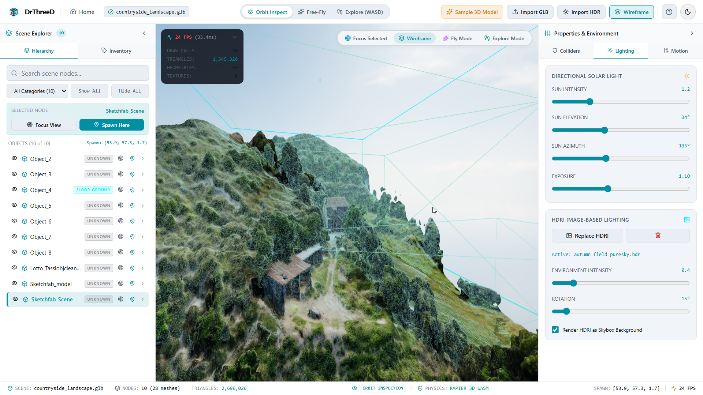
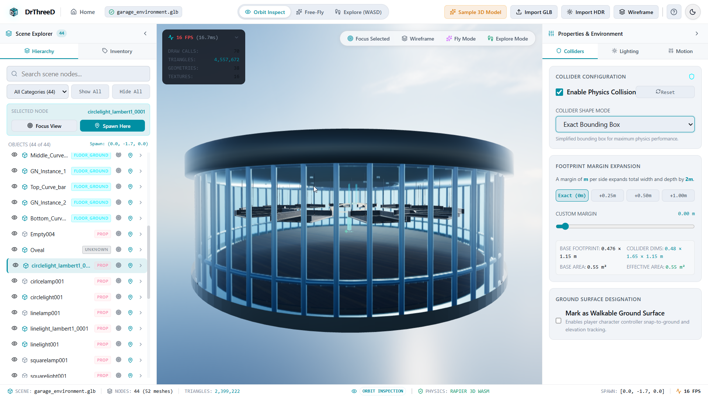
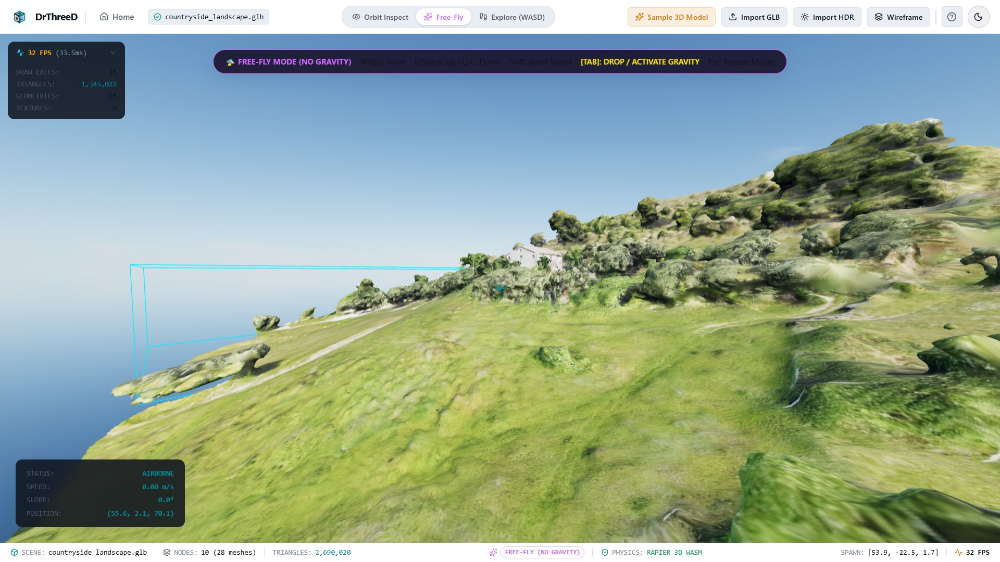

# DrThreeD — 3D Environment Inspection and Traversal Platform

DrThreeD is a browser-based system for inspecting, classifying, and traversing 3D environments created in Blender or similar authoring tools. It combines a scene hierarchy viewer, physics-aware collider configuration, lighting controls, and a first-person exploration workflow into one tool designed for architectural, scientific, and terrain-based environments.

The project is built around a simple principle: users should be able to import a complex 3D scene, understand what each object is doing, adjust the physics that govern navigation, and move through the environment in a way that feels stable, realistic, and usable.

---

## Overview

This system is intended for teams working with:

- Outdoor terrain and landscape assets
- Habitat or building modules
- Research outposts and modular structures
- Large imported GLB scenes with uneven ground and walkable surfaces
- Interactive visual validation before deployment or gameplay testing

Instead of treating a 3D environment as a static asset, DrThreeD turns it into an inspectable, editable, and traversable world. Users can load a model, inspect hierarchy and object metadata, identify potential ground surfaces, configure collision behavior, and experiment with how a human character moves across the scene.

---

## Why this system matters

Modern 3D scenes often arrive with hundreds of meshes, inconsistent naming, and no clear walking rules. In real projects, this causes several problems:

- It is hard to tell which objects are terrain, walls, props, or furniture.
- Physics colliders may be missing or poorly scaled.
- Ground surfaces may be too steep or too rough for reliable character movement.
- Lighting and environmental context are difficult to validate in-browser.

DrThreeD solves those issues by combining scene analysis, physics tuning, and first-person traversal in a single inspection workflow. It helps convert raw model data into a navigable environment without leaving the browser.

---

## Core Features

- GLB / glTF asset import and validation
- Scene hierarchy inspection with visibility toggles
- Automatic object classification by naming, dimensions, and structure
- Manual override controls for misclassified objects
- Collider generation for exact boxes, expanded boxes, convex hulls, and triangle meshes
- Walkable ground designation for terrain and floor surfaces
- First-person movement with sprinting, jumping, and ground snapping
- Lighting controls for directional light and HDRI environment setup
- Performance monitoring for FPS, draw calls, triangles, and scene statistics
- Scene cleanup and resource disposal when replacing models

---

## Screenshots

### 1. Terrain inspection and scene analysis



This view shows the main inspection workspace: the imported environment, the scene hierarchy, and the performance HUD. It is the central workspace where users understand the geometry and evaluate the overall structure of the model.

### 2. Collider configuration and object tuning



This panel focuses on physics behavior. Users can select an object, change its collider mode, expand the footprint margin, and define whether it should be treated as walkable ground. The goal is to make collision behavior match the real structure of the environment.

### 3. First-person traversal and free-fly exploration



This view shows the platform in motion. The user can explore the environment from a first-person perspective, evaluate terrain geometry, and test whether the scene supports safe navigation and stable traversal.

---

## System workflow

The platform is designed to support the following workflow:

1. Import an environment model
2. Inspect the object tree and detect scene structure
3. Review classifications and correct them if needed
4. Configure collider modes, margins, and walkable surfaces
5. Test movement in orbit or first-person mode
6. Adjust lighting and environmental conditions
7. Iterate until the scene is both visually and physically valid

This makes the system useful not only as a viewer, but also as a validation and tuning tool for 3D worlds.

---

## Architecture overview

The project is organized into cleanly separated subsystems:

- `app/` — route shell and application entry points
- `pages/` — landing page and inspection workspace
- `components/` — UI panels, viewport, navigation, and utilities
- `engine/` — scene management, rendering, loading, analysis, and lighting
- `physics/` — physics world, colliders, and ground handling
- `player/` — input, motion, and camera controls
- `state/` — central application state
- `utils/` — validation, cleanup, and file safety logic

This separation keeps the project readable and allows each subsystem to evolve independently while remaining connected through the editor state and scene lifecycle.

---

## Technical highlights

### 3D rendering and scene management
The platform uses Three.js to render and inspect the imported environment, including orbiting camera control, scene graph awareness, and object-focused interaction.

### Physics and collision tuning
Rapier 3D WASM powers the collision simulation. The system supports different collider strategies depending on whether the user needs precise geometry, expanded collision boundaries, or terrain-like walkability.

### Terrain traversal and character movement
The player controller supports movement, sprinting, jumping, and ground detection. It uses slope limits, autostep behavior, and walkable-surface markers to help the camera and character remain grounded on real surfaces instead of floating through or sticking to invalid geometry.

### Lighting and environment testing
HDRI-based lighting and configurable sun settings allow users to review the scene under different environmental conditions, making the experience closer to real-world visual evaluation.

---

## Quick start

### Prerequisites
- Node.js 18+
- npm 9+

### Install
```bash
npm install
```

### Run locally
```bash
npm run dev
```

Then open:

- http://localhost:5173

### Run tests
```bash
npm test
```

### Production build
```bash
npm run build
```

---

## Recommended Blender export workflow

To get the best results from imported scenes:

1. Keep units in metric scale and treat 1 Blender unit as 1 meter.
2. Apply transforms before export.
3. Use consistent naming conventions for terrain, walls, structures, props, and equipment.
4. Export as GLB whenever possible for a self-contained package.
5. Keep geometry optimized enough for smooth browser performance.

This makes scene classification and physics generation more reliable in the inspection tool.

---

## Project status and roadmap

### Current strengths
- Browser-based 3D inspection and traversal
- Object classification workflow with user overrides
- Adjustable colliders and walkable surfaces
- Scene validation for imported environments
- Real-time visualization and performance data

### Known limitations
- Multi-file glTF assets with separate external dependencies require more careful packaging.
- Very dense meshes can reduce performance on low-end devices.

### Planned improvements
- Third-person camera mode
- Animated avatar and locomotion improvements
- Dynamic day/night lighting cycle
- Measurement tools and slope visualization

---

## License

This project is intended for exploration, prototyping, and environment inspection workflows in research, architecture, simulation, and interactive scene review contexts.

---

## Summary

DrThreeD is a practical 3D environment inspection platform for understanding imported scenes, validating their structure, and preparing them for navigation and simulation. It bridges the gap between raw asset creation and usable, interactive, physically-aware environments.
